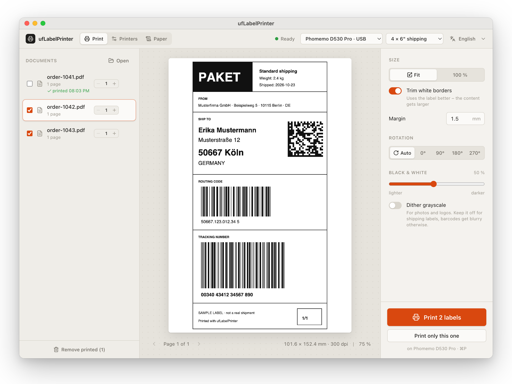

# ufLabelPrinter

**Unfuck your thermal label printer.**

  <picture>
    <source media="(prefers-color-scheme: dark)" srcset="docs/screenshot-dark.png">
    
  </picture>

Cheap thermal label printers are great hardware wrapped in terrible software: apps that
want an account before printing a single label, drivers that crop your shipping label in
half, and a different app for every printer you own.

ufLabelPrinter is one small app for all of them. Drop in a shipping label, click print,
done. No account, no cloud, no driver hunting.

## What it does

- **Prints your shipping labels as they are.** DHL, Deutsche Post, Warenpost or any other
  PDF or image. Labels that are bigger than your paper are scaled to fit, never cut off.
- **Works over USB and Bluetooth.** No pairing dance: find the printer, click add, print.
- **Shows exactly what will come out.** The preview is the real print, dot for dot.
- **Handles a stack of labels at once.** Drop in ten PDFs, print them all, and see which
  ones are done.
- **Remembers your label rolls.** Set up each paper size once and switch with one click
  when you change the roll.
- **Speaks your language.** English, German, French and Spanish.
- **Keeps itself up to date.** New versions install with one click.

## Download

Grab the latest version from the
[releases page](https://github.com/unfuckedapps/ufLabelPrinter/releases/latest):

| System                | File                             |
| --------------------- | -------------------------------- |
| macOS (Apple Silicon) | `ufLabelPrinter_…_aarch64.dmg`   |
| macOS (Intel)         | `ufLabelPrinter_…_x64.dmg`       |
| Windows               | `ufLabelPrinter_…_x64-setup.exe` |
| Linux                 | `.AppImage`, `.deb` or `.rpm`    |

## Getting started

1. **Connect your printer.**
   - USB: plug it in. On first start it is set up automatically; later add it under
     **Printers**.
   - Bluetooth: switch the printer on, open **Printers**, click **Scan Bluetooth LE** and
     **Add**. The app asks once for permission to use Bluetooth.
2. **Tell it what paper is loaded.** Open **Paper**, pick the size (for example
   4 × 6" shipping labels) and choose it in the top right corner.
3. **Print.** Drag your label PDF into the window and press **Print**.

Print the **Test label** from the printer page once: if the frame sits exactly on the
label edge, everything is set up right.

## Works with

| Printer                                 | USB | Bluetooth |
| --------------------------------------- | :-: | :-------: |
| Phomemo D530 Pro                        |  ✓  |     ✓     |
| Vevor Y468BT                            |  ✓  |     ✓     |
| Most other 4" shipping label printers ¹ |  ✓  |   often   |

¹ Anything sold as "TSPL" or "TSC compatible" will very likely work. Tried a printer that
is not listed? Please [open an issue](https://github.com/unfuckedapps/ufLabelPrinter/issues)
and tell us how it went, so it can be recognised automatically.

## Something is off?

- **The label is shifted or cut at an edge.** Print the test label and adjust
  *Fine tuning* on the printer page. After changing the roll, press *Calibrate sensor*.
- **The label comes out upside down.** Turn on *Rotate print by 180°*.
- **The printer stops halfway and beeps.** Choose a lower *Speed* on the printer page.
- **"The printer is busy".** Another program, often the vendor app, is using the
  printer. Close it and try again.
- **Bluetooth printer not found.** Make sure it is switched on and not connected to your
  phone; these printers only talk to one device at a time.
- **Windows and USB.** Windows locks USB printers to its own driver. Use Bluetooth, or add
  the printer in Windows with the *Generic / Text Only* driver and pick it under
  *Show unrecognised devices*.

Still stuck? The printer page has an **Open log folder** button; attach the log to an
[issue](https://github.com/unfuckedapps/ufLabelPrinter/issues).

## For developers

Building from source, how printing works under the hood and how releases are made:
[docs/development.md](docs/development.md). Adding support for another printer:
[docs/adding-a-printer.md](docs/adding-a-printer.md).

## License

[MIT](LICENSE). Printer and vendor names belong to their owners; this project is not
affiliated with Phomemo, Vevor or any other manufacturer.
